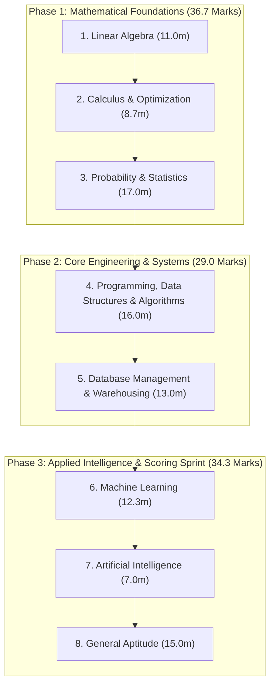

# GATE Data Science & AI (GATE DA) Preparation Pathway
## Option A: Strategic Dependency-Optimized Study Roadmap

> **Based on Comprehensive Analysis of All 195 Official PYQ Questions (GATE DA 2024, 2025, 2026 — 300 Total Marks)**

---

## 1. Master Course Weightage Summary

| Rank | Course | Total Marks (300m) | Avg. Marks / Year | Questions (195) | Trend (2024 $\to$ 2025 $\to$ 2026) | Weightage Share |
| :---: | :--- | :---: | :---: | :---: | :---: | :---: |
| **#1** | **Probability and Statistics** | **51** | **17.0** | 31 | 15m $\to$ 17m $\to$ 19m *(Growing)* | **17.0%** |
| **#2** | **Programming, Data Structures & Algorithms** | **48** | **16.0** | 31 | 20m $\to$ 14m $\to$ 14m *(Consistent)* | **16.0%** |
| **#3** | **General Aptitude** | **45** | **15.0** | 31 | 15m $\to$ 13m $\to$ 17m *(Fixed $\approx$ 15m)* | **15.0%** |
| **#4** | **Database Management and Warehousing** | **39** | **13.0** | 25 | 9m $\to$ 12m $\to$ 18m *(Surging)* | **13.0%** |
| **#5** | **Machine Learning** | **37** | **12.3** | 25 | 16m $\to$ 12m $\to$ 9m *(Steady)* | **12.3%** |
| **#6** | **Linear Algebra** | **33** | **11.0** | 20 | 10m $\to$ 13m $\to$ 10m *(Consistent)* | **11.0%** |
| **#7** | **Calculus and Optimization** | **26** | **8.7** | 17 | 8m $\to$ 13m $\to$ 5m *(Moderate)* | **8.7%** |
| **#8** | **Artificial Intelligence** | **21** | **7.0** | 15 | 7m $\to$ 6m $\to$ 8m *(Consistent)* | **7.0%** |

---

## 2. Strategic Execution Architecture

---

## 3. Course-by-Course Execution Blueprint

### Phase 1: Mathematical Foundations (~36.7 Marks)

#### Course 1: Linear Algebra
- **Weightage:** 11.0 Marks / Year (33 Marks total | 20 Questions)
- **Why First:** Core prerequisite language for SVD, projections, PCA, covariance matrices, and optimization loss functions.
- **Winning Textbook:** [Gilbert Strang — *Introduction to Linear Algebra (4th Ed.)*](books/linear_algebra/index.md)
- **High-Yield Focus Areas:**
  - The 4 Fundamental Subspaces & Rank-Nullity Theorem (*Strang Ch 3*)
  - Orthogonal Projections, Idempotent Matrices ($M^2 = M$), Centering Matrix ($I - \frac{1}{n}\mathbf{1}\mathbf{1}^T$) (*Strang Ch 4.2*)
  - Eigenvalues, Trace/Determinant relationships, and Complex Conjugate pairs (*Strang Ch 6.1*)
  - Singular Value Decomposition (SVD) of rank-1 outer products ($uu^T$) (*Strang Ch 6.7*)
- **Course Index:** [`books/linear_algebra/index.md`](books/linear_algebra/index.md)

---

#### Course 2: Calculus and Optimization
- **Weightage:** 8.7 Marks / Year (26 Marks total | 17 Questions)
- **Why Second:** Builds directly on single-variable and multivariable calculus to prepare for Machine Learning gradient descent.
- **Winning Textbooks:**
  - Primary: [Thomas' Calculus (14th Ed.) — *Hass, Heil, Weir*](books/calculus_and_optimization/index.md)
  - Optimization Reference: [Stephen Boyd — *Convex Optimization*](books/calculus_and_optimization/index.md) (*Chapter 3 only*)
- **High-Yield Focus Areas:**
  - Limits at indeterminate forms ($0/0$, $\infty/\infty$) and Taylor/Maclaurin series expansions (*Thomas Ch 4.5 & 10.9*)
  - Critical points, Concavity, and Second Derivative Test for local/global extrema (*Thomas Ch 4.1 & 4.4*)
  - Piecewise continuity and differentiability conditions (*Thomas Ch 2.5 & 3.2*)
  - Convex sets, strict convexity conditions ($f''(x) > 0$), and unique global minimum (*Boyd Ch 3.1*)
- **Course Index:** [`books/calculus_and_optimization/index.md`](books/calculus_and_optimization/index.md)

---

#### Course 3: Probability and Statistics (#1 Highest Technical Weightage)
- **Weightage:** 17.0 Marks / Year (51 Marks total | 31 Questions)
- **Why Third:** The single largest scoring technical subject in GATE DA. With calculus fresh in mind, continuous joint distributions and expectations are mastered with ease.
- **Winning Textbooks:**
  - Primary (Probability): [Sheldon Ross — *A First Course in Probability (10th Ed.)*](books/probability_and_statistics/index.md) (*Chapters 1–8*)
  - Inference & Estimation: [John A. Rice — *Mathematical Statistics and Data Analysis (3rd Ed.)*](books/probability_and_statistics/index.md) (*Chapters 6 & 8*)
  - Sample Statistics: [Sheldon M. Ross — *Intro to Probability & Statistics for Engineers (6th Ed.)*](books/probability_and_statistics/index.md)
- **High-Yield Focus Areas:**
  - Axioms of probability, Bayes' Theorem, and conditional probabilities (*Ross Ch 2 & 3*)
  - Standard distributions: Poisson, Normal, Uniform, and Exponential Memoryless Property (*Ross Ch 4 & 5*)
  - Joint distributions, Marginal densities, and Law of Total Expectation ($E[E[X|Y]] = E[X]$) (*Ross Ch 6 & 7.5*)
  - Sampling distributions: Normal to $\chi^2(1)$ and $\sum Z_i^2 \sim \chi^2(n)$ (*Rice Ch 6.2*)
  - Maximum Likelihood Estimation (MLE), Fisher Information, and Unbiased Sample Variance ($s^2$ with $n-1$) (*Rice Ch 8.4*)
- **Course Index:** [`books/probability_and_statistics/index.md`](books/probability_and_statistics/index.md)

---

### Phase 2: Core Computer Science & Data Systems (~29.0 Marks)

#### Course 4: Programming, Data Structures, and Algorithms (#2 Highest Weightage)
- **Weightage:** 16.0 Marks / Year (48 Marks total | 31 Questions)
- **Why Fourth:** Highly scoring, algorithmic, and procedural. Provides concrete problem-solving skills tested across every GATE paper.
- **Winning Textbooks:**
  - Algorithms & Complexity: [Cormen et al. — *Introduction to Algorithms (CLRS 3rd Ed.)*](books/programming_data_structures_and_algorithms/index.md)
  - Python & ADTs: [Goodrich, Tamassia, Goldwasser — *Data Structures and Algorithms in Python*](books/programming_data_structures_and_algorithms/index.md)
- **High-Yield Focus Areas:**
  - Python runtime mechanics: recursion trees, mutable default arguments (`def f(lst=[])`), list aliasing vs slicing, `nonlocal` scoping (*Goodrich Ch 1 & 4*)
  - Abstract Data Types: Stacks, Queues, Double-Ended Queues (Deques), Binary Trees (*Goodrich Ch 6 & 8*)
  - Binary search comparison bounds and recurrence relations ($F(n) = F(\lfloor n/2 \rfloor) + 1$) (*CLRS Ch 2.3 & 4.4*)
  - Sorting algorithms: In-place Quicksort partitioning, proportional split complexity, and insertion sort inversions (*CLRS Ch 2.1 & 7.1*)
  - Graph algorithms: BFS/DFS edge classification (tree vs back edges), DAG topological sorting, and path counting (*CLRS Ch 22 & 15*)
- **Course Index:** [`books/programming_data_structures_and_algorithms/index.md`](books/programming_data_structures_and_algorithms/index.md)

---

#### Course 5: Database Management and Warehousing (Fastest Growing)
- **Weightage:** 13.0 Marks / Year (39 Marks total | 25 Questions) — *Surged from 9m in 2024 to 18m in 2026!*
- **Why Fifth:** Exceptionally high marks-to-effort ratio. Very clear mathematical rules (Relational Algebra, Functional Dependencies) and high question repeatability.
- **Winning Textbooks:**
  - Database Systems: [Silberschatz, Korth, Sudarshan — *Database System Concepts (4th Ed.)*](books/database_management_and_warehousing/index.md)
  - Data Warehousing & OLAP: [Jiawei Han & Micheline Kamber — *Data Mining: Concepts and Techniques (3rd Ed.)*](books/database_management_and_warehousing/index.md) (*Chapter 4 only*)
- **High-Yield Focus Areas:**
  - Relational algebra: selection, projection, joins, set difference, and division operator (*Silberschatz Ch 3*)
  - SQL queries: multi-table joins, subqueries (`EXISTS`, `NOT IN`), and `GROUP BY ... HAVING` aggregations (*Silberschatz Ch 4*)
  - Functional Dependencies: Armstrong's axioms, attribute closure $(X)^+$, candidate keys, 3NF, and BCNF testing (*Silberschatz Ch 7*)
  - Physical Indexing: B+ Tree fanout, node capacities, leaf splits, and Hash indexes (*Silberschatz Ch 12*)
  - Data Warehousing: Fact/Dimension tables, star/snowflake schemas, OLAP operations (roll-up, drill-down, slice, dice), and cuboid counts with concept hierarchies (*Han & Kamber Ch 4*)
- **Course Index:** [`books/database_management_and_warehousing/index.md`](books/database_management_and_warehousing/index.md)

---

### Phase 3: Applied Intelligence & Scoring Sprint (~34.3 Marks)

#### Course 6: Machine Learning
- **Weightage:** 12.3 Marks / Year (37 Marks total | 25 Questions)
- **Why Sixth:** With Linear Algebra (SVD/projections), Calculus (derivatives/Hessians), and Probability (Bayes/Gaussians) completed, Bishop's chapters unlock effortlessly.
- **Winning Textbooks:**
  - Core ML: [Christopher Bishop — *Pattern Recognition and Machine Learning (PRML)*](books/machine_learning/index.md)
  - Trees & Naive Bayes: [Tom M. Mitchell — *Machine Learning*](books/machine_learning/index.md) (*Chapters 3, 6, 8*)
- **High-Yield Focus Areas:**
  - Supervised Taxonomy: Generative vs Discriminative models (*Bishop Ch 1.5 & 4.2*)
  - Linear classification: Fisher's Linear Discriminant ($S_W^{-1}S_B u = \lambda u$), geometric margin, and Perceptron criterion (*Bishop Ch 4.1*)
  - Support Vector Machines: Separating hyperplanes, support vectors, and soft/hard margins (*Bishop Ch 7.1*)
  - Ridge Regression: $L_2$ regularization, multicollinearity handling, and normal equations $w = (X^TX + \lambda I)^{-1}X^Ty$ (*Bishop Ch 3.1.4*)
  - Decision Trees: Entropy, Information Gain calculation, and ID3 algorithm (*Mitchell Ch 3.4*)
  - Naive Bayes: Conditional independence assumptions and parameter counts ($2K+1$ for $K$ binary features) (*Mitchell Ch 6.9*)
  - Unsupervised Learning: $k$-Means clustering & Voronoi convexity (*Bishop Ch 9.1*), Hierarchical single/complete linkage (*Han & Kamber Ch 10.3*), and PCA variance maximization (*Bishop Ch 12.1*)
  - Neural Networks: Multilayer Perceptron parameter counting (weights + biases) and ReLU non-linearities (*Bishop Ch 5.1*)
- **Course Index:** [`books/machine_learning/index.md`](books/machine_learning/index.md)

---

#### Course 7: Artificial Intelligence
- **Weightage:** 7.0 Marks / Year (21 Marks total | 15 Questions)
- **Why Seventh:** Compact, highly standardized, and self-contained syllabus. Guaranteed return on minimal study time.
- **Winning Textbook:** [Russell & Norvig — *Artificial Intelligence: A Modern Approach (4th Ed.)*](books/artificial_intelligence/index.md)
- **High-Yield Focus Areas:**
  - Uninformed Search: Breadth-First Search (BFS), Depth-First Search (DFS), Uniform Cost Search (UCS), completeness and optimality (*AIMA Ch 3.4*)
  - Informed Search: $A^*$ search evaluation function $f(n) = g(n) + h(n)$, heuristic admissibility ($h(n) \le h^*(n)$), and heuristic consistency (*AIMA Ch 3.5 & 3.6*)
  - Adversarial Search: Minimax algorithm on game trees, $\alpha$-$\beta$ pruning ($\alpha$ for MAX, $\beta$ for MIN), and node evaluation (*AIMA Ch 5.2*)
  - Knowledge & Logic: Propositional logic truth tables, material implication, tautologies, First-Order Logic quantifiers ($\forall, \exists$), duality, and entailment ($X \models Y$) (*AIMA Ch 7 & 8*)
- **Course Index:** [`books/artificial_intelligence/index.md`](books/artificial_intelligence/index.md)

---

#### Course 8: General Aptitude (Guaranteed 15 Marks Every Year)
- **Weightage:** 15.0 Marks / Year (45 Marks total | 31 Questions)
- **Why Eighth:** Guaranteed fixed 15 marks (Q.1 to Q.10 in every paper). Best practiced in parallel throughout the journey or as the final test-taking polish.
- **Winning Textbooks:**
  - Quantitative Aptitude: [Dinesh Khattar — *Quantitative Aptitude (4th Ed.)*](books/general_aptitude/index.md)
  - Logical & Spatial Reasoning: [R.S. Aggarwal — *Verbal & Non-Verbal Reasoning*](books/general_aptitude/index.md)
  - Vocabulary: [Norman Lewis — *Word Power Made Easy*](books/general_aptitude/index.md)
  - Discrete Math: [Kenneth Rosen — *Discrete Mathematics (7th Ed.)*](books/general_aptitude/index.md)
- **High-Yield Focus Areas:**
  - Question 1 Tradition: Word analogies (intensity, synonyms, antonyms) (*Lewis & Aggarwal*)
  - Spatial Aptitude: 3D cube & dice unfolding nets, planar shape assembly, cross-sections of solids (*Aggarwal*)
  - Quantitative: Divisibility rules, permutations/combinations, geometric series sums, logarithms, and pie chart data interpretation (*Khattar*)
  - Discrete Counting: Planar graph coloring, stars and bars integer partitions, set bijections/involutions (*Rosen*)
- **Course Index:** [`books/general_aptitude/index.md`](books/general_aptitude/index.md)

---

## 4. Master Milestone Checklist

- [x] **Milestone 1: Linear Algebra** — [Interactive HTML Syllabus](syllabus/phase1/linear%20algebra/linear-algebra-syllabus.html) | [Folder](syllabus/phase1/linear%20algebra/)
- [x] **Milestone 2: Calculus & Optimization** — [Interactive HTML Syllabus](syllabus/phase1/calculus%20and%20optimization/calculus-and-optimization-syllabus.html) | [Folder](syllabus/phase1/calculus%20and%20optimization/)
- [x] **Milestone 3: Probability & Statistics** — [Interactive HTML Syllabus](syllabus/phase1/probability%20and%20statistics/probability-and-statistics-syllabus.html) | [Folder](syllabus/phase1/probability%20and%20statistics/)
- [x] **Milestone 4: Programming, DSA** — [Interactive HTML Syllabus](syllabus/phase2/programming%20data%20structures%20and%20algorithms/programming-data-structures-and-algorithms-syllabus.html) | [Folder](syllabus/phase2/programming%20data%20structures%20and%20algorithms/)
- [x] **Milestone 5: Database Management & Warehousing** — [Interactive HTML Syllabus](syllabus/phase2/database%20management%20and%20warehousing/database-management-and-warehousing-syllabus.html) | [Folder](syllabus/phase2/database%20management%20and%20warehousing/)
- [x] **Milestone 6: Machine Learning** — [Interactive HTML Syllabus](syllabus/phase3/machine%20learning/machine-learning-syllabus.html) | [Folder](syllabus/phase3/machine%20learning/)
- [x] **Milestone 7: Artificial Intelligence** — [Interactive HTML Syllabus](syllabus/phase3/artificial%20intelligence/artificial-intelligence-syllabus.html) | [Folder](syllabus/phase3/artificial%20intelligence/)
- [x] **Milestone 8: General Aptitude** — [Interactive HTML Syllabus](syllabus/phase3/general%20aptitude/general-aptitude-syllabus.html) | [Folder](syllabus/phase3/general%20aptitude/)
